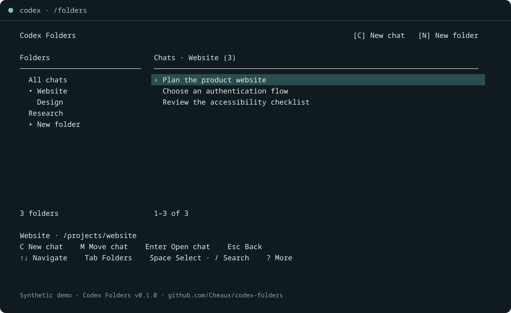

# Codex Folders — folders for Codex CLI chats

[](https://github.com/Cheaux/codex-folders/actions/workflows/ci.yml)
[](https://github.com/Cheaux/codex-folders/releases/latest)
[](LICENSE)

**Create folders, move conversations, and start chats inside a project without leaving Codex.** Codex Folders adds a keyboard chat browser and optional shared instructions and project memory to the Codex CLI.

[Documentation](https://cheaux.github.io/codex-folders/) · [Installation guide](https://cheaux.github.io/codex-folders/install/) · [Download v0.1.1](https://github.com/Cheaux/codex-folders/releases/tag/v0.1.1) · [Report a bug](https://github.com/Cheaux/codex-folders/issues)



*Demo uses fictional chats. Community project by Cheaux; not affiliated with or endorsed by OpenAI.*

## What can I do with it?

- Create folders and subfolders for Codex conversations.
- Move one chat or several at once; undo a move with **Z**.
- Press **C** in a folder to start a new Codex chat there.
- Give a project shared instructions, a default directory for new chats, and a brief of decisions and next steps.
- Ask Codex to find a decision in other chats belonging to the same project, with source references.
- Open another chat while keeping the previous terminal session alive.

**All chats is your home for chats outside folders.** Filing a chat removes it from that home; choose its folder to find it again. Moving it back restores it to All chats. Codex-archived conversations stay hidden. These are conversation folders, separate from directories on disk.

## Commands inside Codex

These commands require [Codex Command Extensions](https://github.com/Cheaux/codex-command-extensions), the shared terminal host, and `codex-folders enable`.

| Command or key | What it does |
| --- | --- |
| `/folders` | Open the chat folder browser. |
| `/resume` | Open the folder browser instead of the original picker. |
| `/resumedbg` | Open the original Codex chat picker. Suggested as “Open the original chat picker”. |
| **Ctrl+X**, then **F** | Open folders while preserving your unfinished draft. |
| **Ctrl+X**, then **B** | Switch between retained terminal views. |

`/resume ID` and other `/resume` arguments keep their native behavior. `/folders` and `/resumedbg` appear in the host's command suggestions alongside Codex's own commands. The host provides terminal interception and suggestions; installing the native plugin alone does not register these slash commands.

You can also ask Codex naturally:

> Create a project folder called Website and move this chat into it.
>
> What did we decide about authentication in this project's other chats?
>
> Save our decisions and next steps in the shared project brief.

## Install

Requires **Node.js 24+**, **npm**, the official **Codex CLI** with plugin/App Server support, and **Python 3** for the terminal host. Linux is verified with Codex CLI **0.163.0**. The host has a Linux/macOS PTY backend; macOS is untested. Its terminal integration is unavailable on Windows. Standalone CLI/MCP use on Windows is unverified.

In a Bash or Zsh terminal, download the two built release packages and install them locally:

```sh
mkdir -p /tmp/codex-folders-install
cd /tmp/codex-folders-install

curl -fLO https://github.com/Cheaux/codex-command-extensions/releases/download/v0.1.2/codex-terminal-extensions-0.1.2.tgz
curl -fLO https://github.com/Cheaux/codex-folders/releases/download/v0.1.1/codex-folders-0.1.1.tgz

npm install --global --prefix "$HOME/.local" --ignore-scripts ./codex-terminal-extensions-0.1.2.tgz ./codex-folders-0.1.1.tgz
export PATH="$HOME/.local/bin:$PATH"

codex-folders install
codex-folders enable
```

Add `export PATH="$HOME/.local/bin:$PATH"` to your shell startup file if needed. Downloads come from GitHub Releases; no npm registry publication is required. Downloading first also works with npm's default restrictions on remote package installation.

**Open a new `codex` terminal**, review the two Codex Folders hooks in **`/hooks`**, and trust them if you want automatic project context. Then type **`/folders`**. You can keep existing conversations and jobs running; they keep their already-loaded launcher version.

The host owns one reversible user-local `codex` launcher and shares it with other extensions such as [Codex Remote](https://github.com/Cheaux/codex-remote). Folders supplies its own commands, browser, and local data. It does not patch the official Codex executable. See the [installation guide](https://cheaux.github.io/codex-folders/install/) for checksums, updates, custom paths, and removal.

## Make your first folder

1. Type `/folders`, then press **N**.
2. Enter a name such as `Website`.
3. Choose whether the chats share instructions and project memory, or just use the folder for organization.
4. To file an existing chat, choose **All chats**, press **Tab** to reach the chat list, select a chat, and press **M**. Real folders appear first in the move picker.
5. To start a chat in the folder, select the folder and press **C**. Its first normal Codex turn verifies its actual chat ID, files it, loads context, and waits for your task. This uses your normal Codex session and usage.

| Browser key | Action |
| --- | --- |
| Arrows / Tab | Navigate / switch between folders and chats. |
| N / C | New folder / new chat in the selected folder. |
| M / Space / Z | Move / select multiple chats / undo a move. |
| R / D | Rename / delete a folder. Deleting returns its chats to All chats. |
| E | Edit project instructions, brief, or default directory using your editor. |
| / / F5 | Search titles and directories / refresh the chat list. |
| ? / Esc / Q | More actions / return to Codex. |

## Shared project context

A plain folder organizes chats. A **project folder** also shares user-written instructions and a revisioned brief across its chats and descendant folders. Project roots cannot nest inside another project. Moving an existing chat never changes its working directory.

The plugin includes **14 MCP tools** for folders, chat membership, undo, resume/new-chat commands, project context, scoped message search, source reading, and memory history. The `chat-folders` skill tells Codex how to use them, identify the current chat explicitly, and maintain a concise brief. Trusted SessionStart and UserPromptSubmit hooks load the project's instructions and brief automatically.

Data lives locally in `${CODEX_HOME:-~/.codex}/folders/folders.db`, including folder assignments, instructions, brief revisions, and a search index of retrieved project messages. The brief is a maintained summary, not a copy of every conversation or a guarantee of perfect recall. Explicit tools work without trusted hooks. There is no separate model service, API key, or background summarizer; context returned to Codex participates in your normal Codex conversation.

Read [how shared context works](https://cheaux.github.io/codex-folders/context/) for inheritance, source references, privacy, and backups.

## Compatibility and troubleshooting

```sh
codex-folders doctor
codex-terminal status --json
```

- **`/folders` is missing:** confirm the host is installed, run `codex-folders enable`, check that `~/.local/bin` precedes the official CLI directory in `PATH`, and open a new terminal. Existing running wrappers keep their loaded code.
- **Prefer the original chat picker:** use `/resumedbg`. To remove Folders shortcuts, run `codex-folders disable`; the shared host and other providers remain.
- **No automatic project context:** review both Folders hooks in `/hooks` and confirm the chat belongs to a project folder.
- **Using another launcher:** the host refuses to overwrite an unrelated `codex` wrapper. Review [custom launcher setup](https://cheaux.github.io/codex-folders/install/#custom-paths-and-launchers).
- **Using no terminal host:** run `codex-folders` in a normal terminal for the standalone browser, or use the plugin's conversational tools. These work independently of the host.

Terminal scrolling, drafts, titles, resize, native resume, and retained views have automated PTY coverage. Linux is the verified platform; terminal behavior can vary by Codex version and emulator. Each retained chat is a live process and uses memory: exit views you no longer need. See [troubleshooting](https://cheaux.github.io/codex-folders/troubleshooting/) and the [FAQ](https://cheaux.github.io/codex-folders/faq/).

## Development and contributing

```sh
npm ci
npm run check
npm run build
npm test
npm run test:pty
npm run test:package
```

The PTY and package checks require `codex-terminal` from the pinned host release on `PATH` (see the CI workflow). Tests use synthetic chats and isolated temporary stores. See [CONTRIBUTING.md](CONTRIBUTING.md) for architecture and release instructions.

[MIT license](LICENSE). Bundled third-party license notices are included in release packages under `dist/THIRD_PARTY_NOTICES.txt`.

## Official directory status

GitHub releases are available. This plugin has **not been submitted to or approved for the official ChatGPT/Codex plugin directory**. [Submission preparation](submission/README.md), [data handling](PRIVACY.md), and [license/service information](TERMS.md) are public.

## Which Codex plugin do I need?

| Project | Use it for |
| --- | --- |
| [Codex Folders](https://cheaux.github.io/codex-folders/) | Organize chats into folders and share project instructions and local briefs. |
| [Codex Remote](https://cheaux.github.io/codex-remote/) | Pair the ChatGPT phone app with native Codex and manage remote devices. |
| [Codex Command Extensions](https://cheaux.github.io/codex-command-extensions/) | Add slash-command autocomplete and terminal views for independently installed providers. |

Folders and Remote are independent features. Install the shared host for their terminal shortcuts; their CLI/MCP tools can work without it. Linux is the verified host platform. Each project's compatibility guide describes its untested cases.
